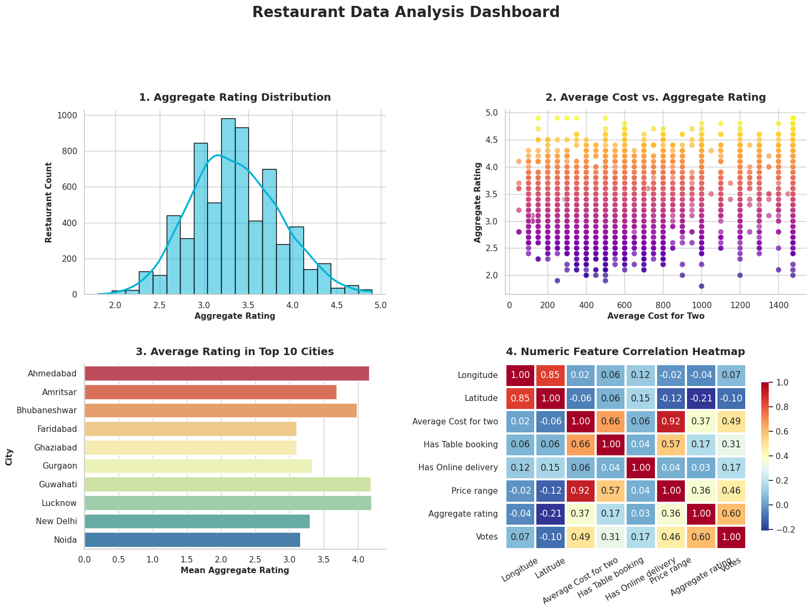
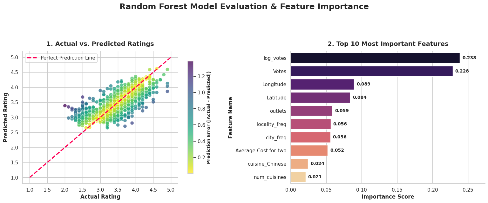

# Zomato Restaurant Rating Prediction

## Problem Statement
Predict a restaurant's rating from its cost, votes, cuisines, location
and services such as online delivery and table booking.

## Dataset
Zomato Restaurants dataset (India only) from Kaggle.
Link: <paste Kaggle link here>

## Project Workflow
1. Data inspection
2. Data cleaning
3. Outlier detection (IQR capping)
4. Exploratory Data Analysis
5. Feature engineering
6. Train-test split (80/20)
7. Model selection
8. Model training and tuning
9. Evaluation and output

## Models Compared
| Model | MAE | RMSE | R2 |
|---|---|---|---|
| Linear Regression | x.xx | x.xx | x.xx |
| Decision Tree | x.xx | x.xx | x.xx |
| Random Forest | x.xx | x.xx | x.xx |
| KNN | x.xx | x.xx | x.xx |

**Best model:** Random Forest (R2 = x.xx)

## Results

## Key Findings
- Votes and cost are the most important features.
- Online delivery restaurants tend to have higher ratings.
- <add your own findings>

## Limitations
- No review text or food quality data.
- Votes are high for older restaurants, so new ones are harder to predict.

## Tools Used
Python, Pandas, NumPy, Matplotlib, Seaborn, Scikit-learn

## How to Run
pip install -r requirements.txt
Open the notebook in Jupyter or Google Colab and run all cells.

## Author
Mohamed Sajith
